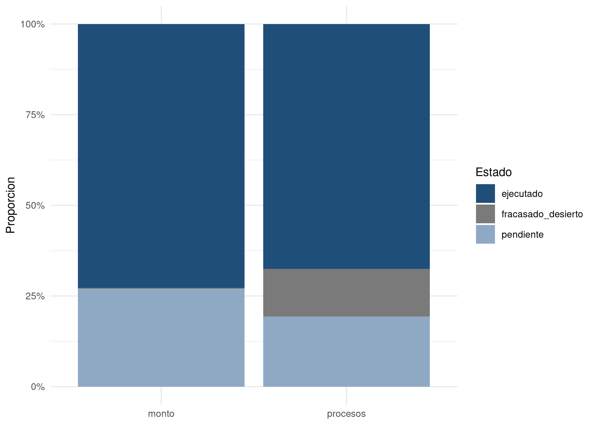
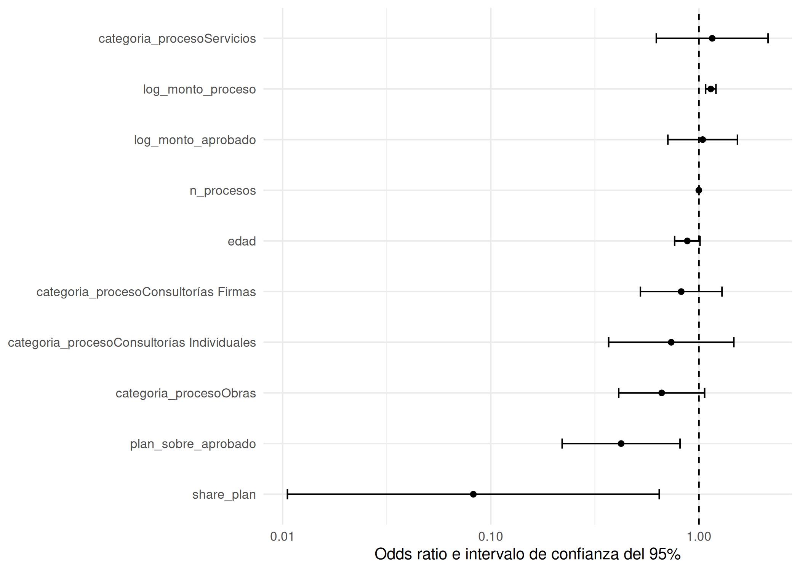

Se ejecutan los planes de adquisiciones del BCIE?
================
Emerson Lopez Zeledon

# 1. Contexto, pregunta y datos

En la muestra principal, 27.0% del presupuesto de los procesos aparece
como pendiente: son \$1,506,824,159 en 2,564 procesos y 48 operaciones.
Esta cifra describe el estado registrado en el PSD, **pendiente no
significa retraso**, porque la base no publica fechas de planificación,
convocatoria, adjudicación o contrato.

La pregunta es: ¿qué proporción del plan aparece ejecutada y qué
características se asocian con que un proceso quede pendiente? La unidad
es el proceso de adquisición, observado una sola vez en el snapshot. Se
seleccionaron operaciones aprobadas hasta 2022, con edad calculada como
2026 menos el año de aprobación. La fuente es la Plataforma de Datos
Abiertos del BCIE, con archivos de procesos, planes y operaciones
descargados manualmente.

# 2. Brecha de ejecución: la diferencia está en el monto

Por número de procesos, 67.5% figura como ejecutado, 19.3% pendiente y
13.2% fracasado o desierto. En monto, la participación pendiente es
27.0%. Los procesos fracasados o desiertos representan 13.2% de los
registros pero 0.24% del presupuesto. Esta diferencia es una oportunidad
para mejorar el registro de montos, no evidencia suficiente para
atribuir fallas a una institución o prestatario.

``` r
estado <- datos %>% dplyr::group_by(estado3) %>% dplyr::summarise(monto = sum(monto_presupuestado_proceso_adquisicion), procesos = dplyr::n(), .groups = "drop") %>% tidyr::pivot_longer(c(procesos, monto), names_to = "medida", values_to = "valor")
ggplot2::ggplot(estado, ggplot2::aes(x = medida, y = valor, fill = estado3)) + ggplot2::geom_col(position = "fill") + ggplot2::scale_fill_manual(values = paleta_estado) + ggplot2::scale_y_continuous(labels = scales::percent) + ggplot2::labs(x = NULL, y = "Proporcion", fill = "Estado") + tema_bcie()
```

<figure>

<figcaption aria-hidden="true">Estado registrado de los procesos.
Fuente: elaboracion propia con datos abiertos del BCIE
(PSD).</figcaption>
</figure>

# 3. Modelo y factores asociados

Se estima un logit binario: la variable dependiente vale uno cuando el
proceso está pendiente y cero en los demás casos. El modelo incluye
categoría de proceso, logaritmo de uno más el monto del proceso, peso
del proceso en el plan, logaritmo de uno más el monto aprobado, relación
plan/aprobado, número de procesos y edad. Los errores estándar están
agrupados por operación. La categoría de referencia real es la primera
del factor, Bienes.

El resultado describe correlaciones. En la especificación, un
coeficiente positivo se asocia con mayores odds de estar pendiente,
manteniendo constantes las demás variables. El monto del proceso tiene
un coeficiente de 0.131, mientras que edad tiene un coeficiente de
-0.129. Son asociaciones dentro de un corte transversal y pueden
reflejar características no observadas.

``` r
co <- coeficientes %>% dplyr::filter(termino != "(Intercept)")
ggplot2::ggplot(co, ggplot2::aes(x = odds_ratio, y = reorder(termino, odds_ratio))) + ggplot2::geom_vline(xintercept = 1, linetype = "dashed") + ggplot2::geom_point() + ggplot2::scale_x_log10() + ggplot2::labs(x = "Odds ratio", y = NULL) + tema_bcie()
```

<figure>

<figcaption aria-hidden="true">Odds ratios del logit binario. Fuente:
elaboracion propia.</figcaption>
</figure>

# 4. Semáforo y priorización

La herramienta agrega las probabilidades del modelo por operación
ponderándolas por el monto de cada proceso. El semáforo absoluto marca
rojo cuando la participación pendiente esperada es al menos 60%, o al
menos 40% si la operación tiene seis años o más, amarillo desde 30% y
verde por debajo de ese umbral. El color siempre se acompaña con una
etiqueta y una regla explícita. El resultado permite ordenar
acompañamiento y revisión de portafolio, no sustituye la revisión
técnica.

Hay 0 operaciones en rojo según la regla absoluta. El top 10 se define
por monto pendiente esperado. Las operaciones más grandes pueden
aparecer primero aunque su porcentaje no sea extremo: la priorización
combina magnitud y probabilidad.

``` r
top <- operaciones %>% dplyr::arrange(dplyr::desc(monto_pendiente)) %>% dplyr::slice_head(n = 10)
ggplot2::ggplot(top, ggplot2::aes(x = monto_pendiente, y = reorder(numero_prestamo, monto_pendiente))) + ggplot2::geom_col(fill = "#C62828") + ggplot2::scale_x_continuous(labels = scales::label_dollar()) + ggplot2::labs(x = "Monto pendiente esperado, USD", y = "Numero de prestamo") + tema_bcie()
```

<figure>

<figcaption aria-hidden="true">Operaciones ordenadas por monto pendiente
esperado. Fuente: elaboracion propia.</figcaption>
</figure>

# 5. Recomendaciones y limitaciones

Primero, usar el semáforo en revisiones periódicas para identificar
operaciones antiguas con montos pendientes elevados. Segundo, combinar
la alerta con acompañamiento diferenciado por categoría y organismo
ejecutor, sin tratar la predicción como veredicto. Tercero, publicar
fechas de hitos de adquisición para que “pendiente” pueda distinguirse
de un retraso observable. Finalmente, mejorar la consistencia de los
montos de procesos fracasados o desiertos para que el análisis
financiero no quede dominado por subregistro.

La cobertura es parcial: el PSD no necesariamente representa todo el
universo de adquisiciones y la información es ingresada por
prestatarios. La muestra tiene 48 operaciones, está concentrada en
países y sectores específicos, y es un único snapshot. El modelo no
incluye país ni sector, no utiliza bootstrap ni modela las tres
categorías de estado simultáneamente. La validación LOOO deja una
advertencia útil: el MAE es 20.2%, frente a 22.0% del benchmark
constante. Esto mejora la comparación, pero no convierte el resultado en
predicción temporal.

La lectura práctica de estos resultados es deliberadamente prudente. Una
operación roja no es una operación fallida: es una señal para preguntar
si el plan sigue vigente, si el monto está actualizado, si existen
cuellos de botella administrativos o si el PSD necesita una
actualización. Del mismo modo, una operación verde no garantiza
ejecución completa. La herramienta permite ordenar recursos escasos de
seguimiento y hacer explícitos los criterios usados para escoger
prioridades.

La apertura de datos hace posible esta conversación con información
común entre equipos. También hace visibles las mejoras que más
aumentarían el valor público del sistema: identificadores estables,
fechas de cada hito, actualización periódica de estados y montos
comparables entre plan y proceso. Con esas mejoras, una futura versión
podría distinguir con precisión entre un proceso previsto, uno en curso
y uno efectivamente atrasado. Mientras tanto, el semáforo debe
acompañarse de expediente, criterio profesional y comunicación
constructiva con las unidades ejecutoras. Ese enfoque permite que la
transparencia sea también una herramienta de aprendizaje institucional:
cada revisión puede devolver información para corregir planes,
actualizar supuestos y mejorar la calidad de la próxima publicación.

# Anexo metodológico

**Limpieza.** `Scripts/01_cleaning.R` lee los tres CSV del portal con
`readr::read_csv`, armoniza estados, suma planes cuando un préstamo
tiene varias filas, agrega operaciones por línea de crédito y une
procesos, planes y operaciones. La muestra principal conserva
operaciones aprobadas hasta 2022. Los estados ejecutado, pendiente y
fracasado/desierto siguen las definiciones de `objetivo.md`.

**Estimación y validación.** `Scripts/02_modelo.R` estima el logit con
`stats::glm(family = binomial)`, calcula errores agrupados con
`sandwich::vcovCL`, obtiene probabilidades por proceso y las agrega por
operación. La validación leave-one-operation-out reestima el modelo
dejando una operación fuera en cada iteración. Se reportan MAE, RMSE,
correlación, calibración por deciles y sensibilidad en cuatro muestras.

**Reproducibilidad.** Ejecutar `Rscript Scripts/01_cleaning.R`,
`Rscript Scripts/02_modelo.R`, `Rscript 03_plots.R` y los comandos de
render indicados en el README. Version de R utilizada en esta ejecucion:
4.6.1.

# Declaraciones

- Autoria original: Declaro que este trabajo es de mi autoria original.
- Conflictos de interes: Declaro que no tengo conflictos de interes
  relacionados con este trabajo.
- Consentimientos, no se utilizaron entrevistas ni testimonios de
  personas, no aplica consentimiento informado.
- Uso de inteligencia artificial: Declaro que el documento final sera
  redactado y revisado manualmente por mi, sin uso de inteligencia
  artificial generativa para su redaccion.
  `[COMPLETAR: confirmar antes de entregar]`
- Contacto: Emerson Zeledon, <emerson.zeledon.ni@gmail.com>.

# Referencias

Banco Centroamericano de Integración Económica. (s. f.). *Plataforma de
Datos Abiertos*. <https://datosabiertos.bcie.org>.

Zeledon, E. (2026). *Se ejecutan los planes de adquisiciones del BCIE?*
\[Repositorio de código\].
<https://github.com/Emerson-nic/Second_Datathon_BCIE>.
