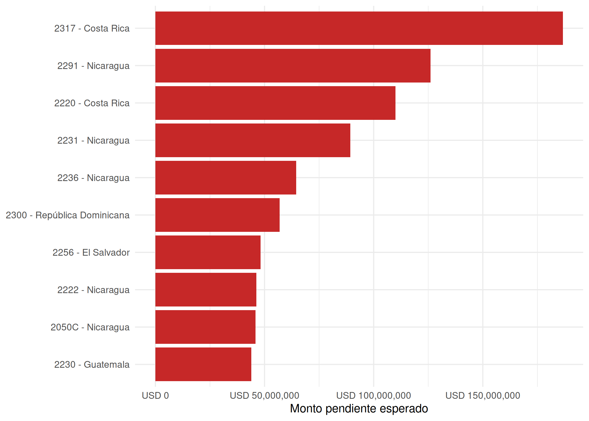

Se ejecutan los planes de adquisiciones del BCIE?
================
Emerson Lopez Zeledon

# 1. Contexto, pregunta y datos

En la muestra analizada, USD 1,506,824,159 del presupuesto corresponde a
procesos que aparecen con estado pendiente, es decir, 27.0% del total
registrado. Esta cifra describe lo que figura en los planes de
adquisiciones, no dinero perdido, pagado ni detenido. Tampoco demuestra
que una compra, una consultoría o una obra esté retrasada. Para saberlo
harían falta fechas de los hitos de cada proceso, y la base disponible
no las contiene.

Este análisis pregunta cuánto del presupuesto planificado corresponde a
procesos pendientes y qué características se relacionan con ese estado.
La pregunta importa porque las adquisiciones permiten llevar a la
práctica proyectos de desarrollo. Sin embargo, una lista de estados por
sí sola no dice dónde conviene revisar primero. Los datos abiertos del
Banco Centroamericano de Integración Económica (BCIE) permiten construir
una señal para orientar esa revisión. La señal no sustituye los
expedientes ni determina responsabilidades: sirve para identificar
operaciones que podrían requerir una comprobación del estado del plan,
sus montos o la información publicada.

La fuente es la Plataforma de Datos Abiertos del BCIE y, en particular,
su información de seguimiento de adquisiciones, conocida como PSD. El
análisis reúne registros de procesos, planes de adquisiciones y
operaciones. Un proceso es cada compra, obra o servicio incluido en un
plan. Una operación es el préstamo o proyecto al que ese proceso
pertenece. Los archivos se descargaron manualmente y se vincularon
mediante el número de préstamo y la línea de crédito. Como no todos los
registros pudieron emparejarse, la base no representa necesariamente
todas las adquisiciones del Banco.

Cada proceso se observa una sola vez, en una fotografía de los datos. La
muestra principal incluye operaciones aprobadas hasta 2022. Su
antigüedad se calcula con relación al año de la fotografía, 2026. En
total, se analizan 2,564 procesos agrupados en 48 operaciones. Por
tanto, las diferencias entre estados describen este corte transversal y
no cambios a lo largo del tiempo.

# 2. Brecha de ejecución: el monto pendiente supera su peso en el conteo

Los registros se agrupan en tres estados. Se considera ejecutado un
proceso que aparece adjudicado, contratado o con el contrato terminado.
El estado pendiente reúne los procesos que figuran previstos, en curso,
en evaluación, con lista corta o en expresión de interés. El grupo
fracasado o desierto incluye los procesos registrados con esos estados.
En el conteo, 67.5% aparece como ejecutado, 19.3% como pendiente y 13.2%
como fracasado o desierto. Al ponderar por el presupuesto registrado,
los procesos pendientes representan 27.0%. La diferencia entre ambas
medidas se debe a que los procesos tienen montos distintos: contar cada
uno por igual no muestra cuánto presupuesto está asociado a cada estado.

También destaca una diferencia en los registros fracasados o desiertos:
representan 13.2% de los procesos, pero 0.24% del presupuesto. Esto abre
una oportunidad para revisar la calidad de los montos consignados en
esos casos. La diferencia no permite concluir que esos procesos no hayan
tenido costo. Podría deberse a montos no ingresados, valores cero u
otras características de los registros. Una revisión de completitud y
consistencia al actualizar el estado ayudaría a aclarar qué explica esa
brecha.

El presupuesto registrado tampoco equivale a dinero comprometido, pagado
o liberado. Es el valor que el plan asigna al proceso y debe leerse como
tal. Para distinguir una actividad prevista que avanza según su
calendario de otra que enfrenta una demora, sería necesario publicar
fechas de planificación y de los principales hitos, junto con
actualizaciones comparables del estado.

``` r
estado <- datos %>% dplyr::group_by(estado3) %>% dplyr::summarise(monto = sum(monto_presupuestado_proceso_adquisicion), procesos = dplyr::n(), .groups = "drop") %>% tidyr::pivot_longer(c(procesos, monto), names_to = "medida", values_to = "valor")
ggplot2::ggplot(estado, ggplot2::aes(x = medida, y = valor, fill = estado3)) + ggplot2::geom_col(position = "fill") + ggplot2::facet_wrap(~medida, scales = "free_y") + ggplot2::scale_fill_manual(values = paleta_estado) + ggplot2::scale_y_continuous(labels = scales::percent) + ggplot2::labs(x = NULL, y = "Proporción", fill = "Estado") + tema_bcie()
```

<figure>

<figcaption aria-hidden="true">La proporción de procesos pendiente es
menor que su proporción del presupuesto. Fuente: elaboración propia con
datos abiertos del BCIE (PSD).</figcaption>
</figure>

# 3. Modelo y factores asociados: una probabilidad orienta, no sentencia

Para resumir qué características aparecen asociadas con el estado
pendiente, se estima un modelo logit binario. El modelo asigna el valor
uno a los procesos pendientes y cero a todos los demás, incluidos los
ejecutados, fracasados y desiertos. No predice directamente si una
adquisición se completará ni cuándo: estima, a partir de las
características observadas, una probabilidad de que un registro
pertenezca al grupo pendiente.

Entre las características consideradas están el tipo de adquisición, el
monto presupuestado del proceso, la proporción que representa dentro del
plan, el monto aprobado para la operación, la relación entre el plan y
ese monto, el número de procesos y la antigüedad de la operación. Los
montos entran como logaritmo de uno más su valor para reducir la
influencia de diferencias de escala muy grandes. El modelo no incluye
país ni sector como variables explicativas. Para comparar las categorías
de adquisición, Bienes es la categoría de referencia. Las demás se
interpretan con relación a ella.

El gráfico presenta razones de momios (odds ratios), una forma de
resumir cómo cambia la relación entre la probabilidad de estar pendiente
y la de no estarlo cuando cambia una característica, manteniendo las
demás constantes. Un valor mayor que uno indica una asociación positiva
y uno menor que uno una asociación negativa. Ninguno demuestra que esa
característica cause el estado. Los intervalos muestran la incertidumbre
de las estimaciones. Además, los errores estándar se agrupan por
operación porque varios procesos de un mismo préstamo pueden compartir
circunstancias. Este ajuste reconoce esa relación entre observaciones,
pero no elimina posibles factores omitidos ni convierte el análisis en
causal.

Los coeficientes del logit están expresados en una escala que no es
intuitiva por sí sola. En esta muestra, el coeficiente asociado al
logaritmo del monto del proceso es 0.131 y el de edad es -0.129. Para
interpretarlos hay que considerar su escala y sus intervalos de
confianza, no solo el signo. El modelo resume patrones presentes en
estos datos y ayuda a ordenar una revisión. No explica por qué un
proceso particular tiene el estado que muestra el portal.

``` r
co <- coeficientes %>% dplyr::filter(termino != "(Intercept)")
ggplot2::ggplot(co, ggplot2::aes(x = odds_ratio, y = reorder(termino, odds_ratio))) + ggplot2::geom_vline(xintercept = 1, linetype = "dashed") + ggplot2::geom_errorbar(ggplot2::aes(xmin = ic_95_inf, xmax = ic_95_sup), orientation = "y", width = .2) + ggplot2::geom_point() + ggplot2::scale_x_log10() + ggplot2::labs(x = "Odds ratio e intervalo de confianza del 95%", y = NULL) + tema_bcie()
```

<figure>

<figcaption aria-hidden="true">Odds ratios del logit binario con errores
estándar agrupados por operación. Fuente: elaboración
propia.</figcaption>
</figure>

# 4. Semáforo y priorización: dos operaciones muestran por qué mirar monto y porcentaje

Para pasar de probabilidades por proceso a una señal por operación, se
multiplica la probabilidad estimada de cada proceso por su monto
presupuestado y luego se suman esos valores. Así se obtiene un monto
pendiente esperado y la proporción que representa del presupuesto total
de la operación. “Esperado” significa que es una estimación del modelo,
no una suma de procesos que el portal confirme como pendientes.

La regla absoluta asigna rojo cuando la proporción estimada llega al
menos a 60%, o a 40% en operaciones de seis años o más. Asigna amarillo
desde 30% y verde por debajo de ese umbral. El nombre del color siempre
acompaña su representación para que la clasificación no dependa
únicamente de distinguir colores. El top diez, en cambio, ordena por
monto pendiente esperado: considera tanto la proporción estimada como el
tamaño del presupuesto. El ranking se calcula con el modelo ajustado a
toda la muestra. Más adelante se presenta por separado una prueba que
deja fuera una operación cada vez. En esta muestra, 0 operaciones quedan
en rojo según la regla absoluta.

Dos casos ayudan a entender por qué la señal no es un veredicto. El
préstamo 2317, de Costa Rica, ocupa el puesto 1 del top diez por monto
esperado. De sus 367 procesos, 78 figuran como pendientes. El modelo
estima para la operación USD 186,645,910 de monto pendiente esperado,
equivalente a 28.2% de su presupuesto. En los registros observados, los
procesos pendientes suman USD 184,956,012, o 27.9% del total. La
proximidad entre las proporciones estimada y observada en este ejemplo
no garantiza que el modelo acierte igual en otras operaciones.

El préstamo 2291, de Nicaragua, ocupa el puesto 2. Sus 14 procesos
aparecen ejecutados en el corte, aunque el modelo estima USD 126,080,120
de monto pendiente esperado, equivalente a 36.0% del presupuesto. Esta
diferencia muestra para qué sirve la alerta y cuál es su límite: señalar
algo que conviene contrastar con el expediente, no reemplazar el
registro ni afirmar que hay retraso. El primer caso destaca por el monto
estimado y el segundo, por la proporción que ese monto representa.

Para comprobar si la señal aporta información más allá de una referencia
sencilla, se realiza una validación fuera de muestra llamada
leave-one-operation-out (LOOO). En cada ronda se apartan todos los
procesos de una operación, se estima el modelo con las demás y se
calcula la predicción para la operación excluida. El error absoluto
medio (MAE) resume cuánto difieren, en promedio, las proporciones
predichas y observadas. Para el modelo es 20.2%, frente a 22.0% en un
benchmark constante, que asigna la misma probabilidad promedio a todos
los procesos. El error cuadrático medio (RMSE) penaliza especialmente
las diferencias grandes: es 27.5% para el modelo y 27.7% para el
benchmark. La comparación ofrece una comprobación útil dentro de esta
muestra, pero no prueba que el modelo anticipe resultados futuros ni que
funcione igual en otra cartera. Por eso las estimaciones deben usarse
como apoyo a la revisión profesional.

``` r
top <- operaciones %>% dplyr::arrange(dplyr::desc(monto_pendiente)) %>% dplyr::slice_head(n = 10) %>% dplyr::mutate(etiqueta = paste0(numero_prestamo, " - ", pais))
ggplot2::ggplot(top, ggplot2::aes(x = monto_pendiente, y = reorder(etiqueta, monto_pendiente))) + ggplot2::geom_col(fill = "#C62828") + ggplot2::scale_x_continuous(labels = scales::label_dollar(prefix = "USD ")) + ggplot2::labs(x = "Monto pendiente esperado", y = NULL) + tema_bcie()
```

<figure>

<figcaption aria-hidden="true">Las diez operaciones con mayor monto
pendiente esperado. Fuente: elaboración propia.</figcaption>
</figure>

# 5. Recomendaciones y limitaciones: convertir la alerta en aprendizaje institucional

Una forma práctica de usar estos resultados es llevar el semáforo y el
top diez a las revisiones periódicas de la cartera. Ante una alerta, el
equipo responsable puede comprobar el expediente, confirmar si el
proceso sigue previsto, verificar si el monto cambió y revisar cuándo se
actualizó el estado por última vez. Si hace falta, esa conversación
puede identificar dónde sería útil un acompañamiento técnico. El ranking
ayuda a ordenar las revisiones por monto pendiente esperado, pero no
decide qué operación debe recibir apoyo ni reemplaza el criterio de
quienes la gestionan.

El [dashboard del
proyecto](https://connect.posit.cloud/em3r/content/01a20a50-e45d-b6b9-9e3c-9c72aaae51a9)
permite filtrar las operaciones, consultar el semáforo y explorar cómo
cambia la probabilidad estimada para un proceso hipotético. La
calculadora es ilustrativa: no evalúa oficialmente a un prestatario ni
produce una recomendación automática. Sus resultados reflejan
asociaciones observadas en los datos y no relaciones de causa y efecto.

Para que una futura alerta sea más precisa, también hace falta mejorar
la información disponible. Publicar fechas de planificación,
convocatoria, evaluación, adjudicación y contrato permitiría comparar el
avance con un calendario y distinguir un proceso previsto de una demora
comprobable. Documentar cómo se actualizan los estados, conservar
identificadores estables y revisar la consistencia de los montos —en
particular en procesos fracasados o desiertos— ayudaría a interpretar
mejor cada registro. Con esa información, los equipos podrían contrastar
las señales con los expedientes, registrar las correcciones y aprender
de una revisión a la siguiente.

Los resultados tienen límites importantes. El cruce de fuentes es
parcial y depende de la información que los prestatarios registran en el
PSD. Las 48 operaciones se observan en una sola fotografía, no en un
panel que siga los mismos procesos a lo largo del tiempo. Como no hay
fechas completas de los hitos de adquisición, el estado “pendiente” no
permite determinar si existe retraso. Además, varios procesos pertenecen
a una misma operación y pueden compartir condiciones. Los errores
estándar agrupados consideran esa dependencia, pero no resuelven las
demás limitaciones. El modelo no incluye país ni sector, y tampoco
observa todas las razones por las que un proceso puede tener cierto
estado. La validación LOOO prueba el desempeño entre operaciones de esta
muestra, no en otros años, carteras o publicaciones. Finalmente, el
monto estimado es una señal para priorizar y no una cifra exacta de
recursos comprometidos.

El valor de este ejercicio está en mostrar qué preguntas pueden hacerse
con datos abiertos y cómo ordenar una revisión sin convertir una
clasificación en un juicio. Incorporar fechas, mantener los estados al
día y mejorar la captura de montos permitiría evaluar con más fundamento
el avance de las adquisiciones. Mientras esos datos no estén
disponibles, cada alerta debe entenderse como una invitación a verificar
la información y decidir si se requiere seguimiento, no como una
conclusión sobre el desempeño del BCIE o de un prestatario.

**Conteo de palabras del cuerpo (sin anexo ni código de gráficos):**
1,936.

# Anexo metodológico

**Datos y preparación.** El análisis utiliza archivos públicos de
procesos de adquisiciones, planes e indicadores de operaciones,
disponibles en el [Portal de Datos Abiertos del
BCIE](https://datosabiertos.bcie.org). Los archivos descargados
manualmente se guardan en `Data/Source-Data/`. La fecha indicada en la
captura de descarga es el 7 de noviembre de 2026. El portal publica los
conjuntos [Procesos de Adquisiciones de
Proyectos](https://datosabiertos.bcie.org/dataset/procesos-de-adquisiciones-de-proyectos)
e [Impacto del
desarrollo](https://datosabiertos.bcie.org/dataset/impacto-del-desarrollo)
bajo Creative Commons Attribution (CC BY), según sus metadatos. La
licencia MIT del repositorio cubre el código, no reemplaza la licencia
ni la atribución correspondientes a los datos. El script
`Scripts/01_cleaning.R` lee los archivos CSV, armoniza los estados, suma
las filas de planes asociadas a distintos organismos ejecutores, agrega
por línea de crédito los datos de operaciones y vincula las fuentes
mediante el número de préstamo o línea de crédito. La muestra principal
conserva operaciones aprobadas hasta 2022. Su edad se calcula restando
el año de aprobación a 2026.

**Clasificación de estados y brecha.** Se agrupan como ejecutados los
procesos adjudicados, contratados o con contrato terminado. El grupo
pendiente reúne los estados previsto, en curso, en evaluación, con lista
corta y expresión de interés en curso. El grupo fracasado o desierto
incluye los registros con esos estados. La brecha observada es el monto
presupuestado de los procesos pendientes dividido entre el monto
presupuestado de todos los procesos de la muestra. Estas categorías
describen lo que consta en la fuente. No informan por sí mismas sobre
retrasos, desembolsos o incumplimientos.

**Modelo y semáforo.** El script `Scripts/02_modelo.R` utiliza una
regresión logística binaria para estimar la probabilidad de que un
proceso figure pendiente, frente a cualquiera de los demás estados.
Incluye la categoría de proceso, el logaritmo de uno más el monto del
proceso, su participación en el plan, el logaritmo de uno más el monto
aprobado, la relación entre el plan y el monto aprobado, el número de
procesos y la edad. Los errores estándar se agrupan por número de
préstamo con `sandwich::vcovCL` y `lmtest::coeftest`. Después, las
probabilidades se ponderan por el monto presupuestado y se suman para
obtener una estimación por operación. El semáforo absoluto aplica los
umbrales indicados en el cuerpo del documento. Además, se calcula una
clasificación relativa que divide las operaciones en tres grupos según
su proporción pendiente estimada.

**Validación y limitaciones.** En la validación leave-one-operation-out
(LOOO), se excluye una operación, se estima el modelo con las restantes
y se evalúa la predicción para la operación excluida. El desempeño se
compara con un benchmark constante y se resume con el error absoluto
medio (MAE), el error cuadrático medio (RMSE) y la correlación. También
se revisan la calibración por deciles, la diferencia entre el monto
pendiente estimado y el observado, y la sensibilidad del modelo en
cuatro muestras. Esta evaluación no es temporal ni causal. La cobertura
del PSD es parcial, los registros dependen de la información ingresada
por los prestatarios y no hay fechas suficientes para verificar
retrasos. La diferencia entre la proporción de procesos fracasados o
desiertos y su proporción del presupuesto motiva una revisión de calidad
de datos, no una atribución de falla.

**Reproducción del análisis.** Desde la raíz del repositorio, ejecutar
`Rscript Scripts/01_cleaning.R`, `Rscript Scripts/02_modelo.R` y
`Rscript Scripts/03_plots.R`, en ese orden. Después se puede generar la
versión para GitHub o el PDF con R Markdown. La versión de R utilizada
es 4.6.1. Los detalles del entorno se consultan con `sessionInfo()`.

# Declaraciones

- Autoría original: Declaro que este trabajo es de mi autoría individual
  y original.
- Conflictos de interés: Declaro que no tengo conflictos de interés
  relacionados con este trabajo.
- Consentimientos: Este análisis utiliza conjuntos de datos públicos del
  BCIE y no incorpora entrevistas ni testimonios. Por ello, no aplica
  consentimiento informado.
- Uso de inteligencia artificial y herramientas: El análisis de datos se
  realizó en R desde RStudio. OpenCode, un asistente de inteligencia
  artificial, se utilizó como apoyo para generar y revisar código y para
  sugerir y editar partes del manuscrito. El autor es responsable de
  revisar el código, verificar las cifras y aprobar la versión final.
- Contacto: Emerson Lopez Zeledon, <emerson.zeledon.ni@gmail.com>.
- ORCID: <https://orcid.org/0009-0009-6423-2883>.

# Referencias

Banco Centroamericano de Integración Económica. (s. f.). *Plataforma de
Datos Abiertos*. <https://datosabiertos.bcie.org>.

Banco Centroamericano de Integración Económica. (s. f.). *Procesos de
Adquisiciones de Proyectos* \[Conjunto de datos, licencia Creative
Commons Attribution (CC BY)\].
<https://datosabiertos.bcie.org/dataset/procesos-de-adquisiciones-de-proyectos>.

Banco Centroamericano de Integración Económica. (s. f.). *Impacto del
desarrollo* \[Conjunto de datos, licencia Creative Commons Attribution
(CC BY)\].
<https://datosabiertos.bcie.org/dataset/impacto-del-desarrollo>.

Licencia Creative Commons Attribution (CC BY).
<http://www.opendefinition.org/licenses/cc-by>.

Lopez Zeledon, E. (2026). *Se ejecutan los planes de adquisiciones del
BCIE?* \[Repositorio de código y materiales\].
<https://github.com/Emerson-nic/Second_Datathon_BCIE>.
<https://doi.org/10.5281/zenodo.24484873>.
