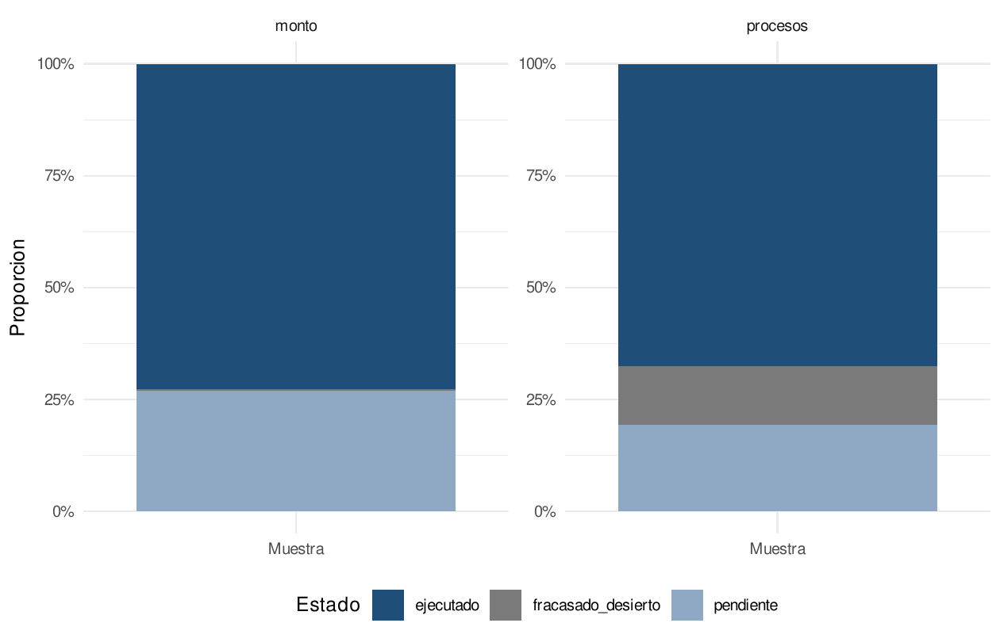
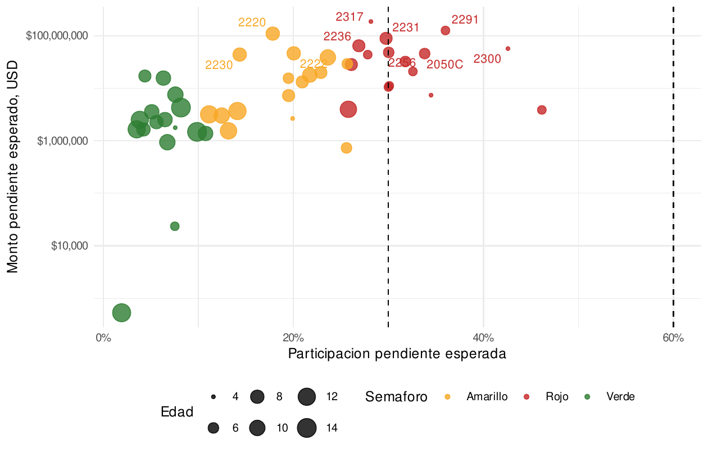
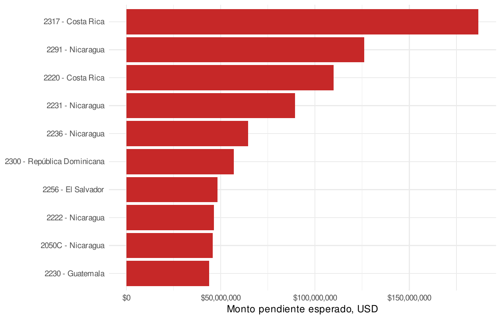

# ¿Se ejecutan los planes de adquisiciones del BCIE?

[English version](README_EN.md)

[](https://connect.posit.cloud/em3r/content/01a20a50-e45d-b6b9-9e3c-9c72aaae51a9)

[](https://doi.org/10.5281/zenodo.24484873)

Este proyecto participa en el Segundo Datathon de Datos Abiertos del BCIE. Utiliza información pública de procesos de adquisición, planes de adquisiciones y operaciones de crédito para medir la brecha observada entre lo planificado y el estado registrado. También construye un semáforo de revisión por operación y una lista de las diez operaciones con mayor monto pendiente esperado.

## Qué problema aborda

Los planes de adquisiciones contienen procesos con distintos estados, pero una fotografía del estado no permite afirmar por sí sola que exista retraso. La base no incluye todas las fechas de planificación, convocatoria, adjudicación y contratación. Por eso el proyecto usa una interpretación prudente, pendiente describe un estado registrado y la herramienta muestra correlaciones útiles para priorizar revisiones.

La pregunta principal es qué proporción del monto planificado aparece ejecutada y qué características se relacionan con que un proceso figure como pendiente.

## Qué hace el proyecto

- Limpia y une los archivos de procesos, planes y operaciones del BCIE.
- Clasifica los estados en ejecutado, pendiente y fracasado o desierto.
- Selecciona un corte transversal de operaciones aprobadas hasta 2022.
- Estima un logit binario de proceso pendiente frente a proceso no pendiente.
- Calcula errores estándar agrupados por operación.
- Valida el modelo con leave-one-operation-out.
- Agrega las probabilidades por monto a nivel de operación.
- Construye un semáforo con reglas transparentes.
- Ordena un top 10 por monto pendiente esperado.
- Genera figuras reproducibles y una aplicación Shiny para Posit Connect.

## Resultados principales

La muestra principal contiene 2,564 procesos y 48 operaciones.

- 19.3% de los procesos figura como pendiente.
- 67.5% figura como ejecutado.
- 13.2% figura como fracasado o desierto.
- El monto pendiente observado es USD 1,506,824,159.
- La brecha pendiente representa 27.0% del presupuesto de la muestra.
- Los procesos fracasados o desiertos representan 13.2% de los procesos y 0.24% del presupuesto.
- La validación LOOO obtiene un MAE de 20.2% y un RMSE de 27.5%.







## Dashboard Shiny

La aplicación está en [`dashboard/app.R`](dashboard/app.R). Está preparada para publicarse manualmente en Posit Connect.

Enlace público, [abrir el dashboard en Posit Connect](https://connect.posit.cloud/em3r/content/01a20a50-e45d-b6b9-9e3c-9c72aaae51a9)

Para probarla localmente, ejecutar desde la raíz del proyecto,

```r
shiny::runApp("dashboard")
```

Para publicarla desde RStudio en Posit Connect, usar `rsconnect::deployApp("dashboard")` después de configurar la cuenta y el servidor.

La aplicación incluye resumen de la brecha, filtros por país, sector y edad, tabla del semáforo, top 10, odds ratios, calculadora de riesgo y metodología.

## Datos

La fuente es la [Plataforma de Datos Abiertos del BCIE](https://datosabiertos.bcie.org). Los archivos originales se descargaron manualmente y se encuentran en `Data/Source-Data/`.

El proyecto no utiliza APIs ni fuentes externas para los cálculos principales. Los datos derivados del modelo se encuentran en `Data/csv/`.

## Metodología

La unidad de análisis es el proceso de adquisición. La muestra principal incluye operaciones aprobadas hasta 2022 y representa un corte transversal único. El modelo estima la probabilidad de que un proceso figure como pendiente usando categoría, monto del proceso, participación en el plan, monto aprobado, relación plan sobre aprobado, número de procesos y edad.

La variable `share_plan` representa la participación del presupuesto de un proceso dentro del monto total del plan. La variable `plan_sobre_aprobado` representa la relación entre el monto total del plan y el monto aprobado de la operación.

El semáforo agrega las probabilidades por monto a nivel de operación. Rojo indica una participación pendiente esperada alta, amarillo una participación intermedia y verde una participación menor. Los umbrales están definidos en el código y se muestran en la metodología.

Los odds ratios mayores que 1 indican una correlación positiva con la probabilidad de quedar pendiente. Para evaluar significancia se debe revisar el intervalo de confianza y el p-valor, un odds ratio mayor que 1 por sí solo no es suficiente.

## Reproducibilidad

Desde la raíz del repositorio ejecutar,

```bash
Rscript Scripts/01_cleaning.R
Rscript Scripts/02_modelo.R
Rscript Scripts/03_plots.R
```

## Estructura del repositorio

```text
.
├── AGENTS.md
├── objetivo.md
├── Scripts/
│   ├── 01_cleaning.R
│   ├── 02_modelo.R
│   └── 03_plots.R
├── Data/
│   ├── Source-Data/
│   └── csv/
├── Plots/
├── Doc/
│   ├── 02_modelo.Rmd
│   └── nota_politica.Rmd
├── dashboard/
│   ├── app.R
│   └── data/
├── README.md
└── README_EN.md
```

## Limitaciones

El PSD es una fotografía y no un panel. La cobertura es parcial y la información es ingresada por prestatarios. No hay fechas suficientes para interpretar pendiente como retraso. El modelo no incluye país ni sector como covariables principales y describe correlaciones. La concentración de procesos por país debe considerarse al interpretar los resultados. El semáforo orienta revisiones y no reemplaza la supervisión técnica.

## Citación

> Lopez, E. 2026. *Se ejecutan los planes de adquisiciones del BCIE?* Código y materiales reproducibles. <https://github.com/Emerson-nic/Second_Datathon_BCIE>. DOI, [10.5281/zenodo.24484873](https://doi.org/10.5281/zenodo.24484873).


