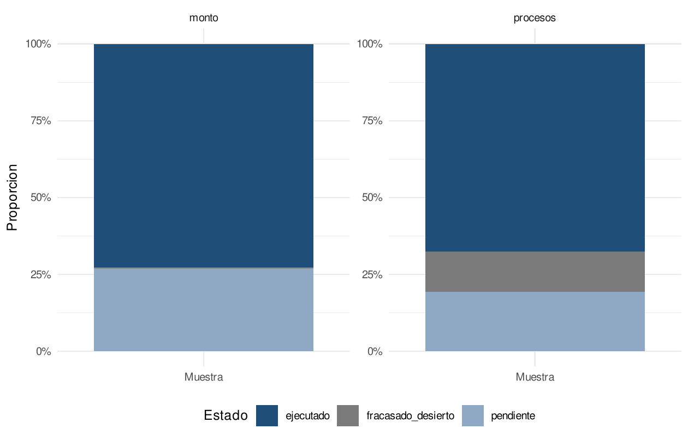
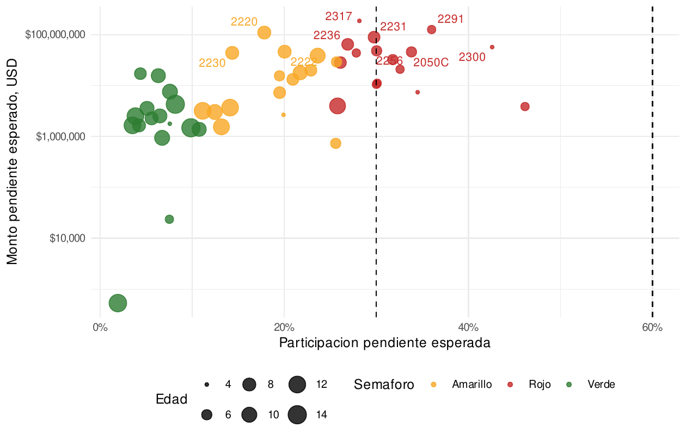
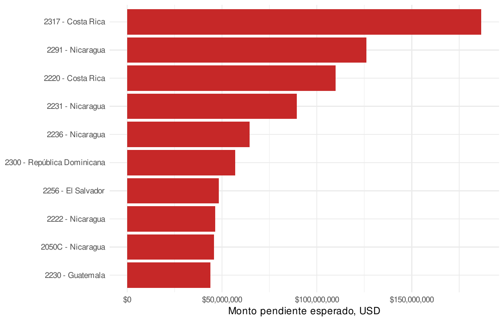

# Are BCIE procurement plans being executed?

[Spanish version](README.md)

[](https://connect.posit.cloud/em3r/content/01a20a50-e45d-b6b9-9e3c-9c72aaae51a9)

[](https://doi.org/10.5281/zenodo.24484873)

This project participates in the Second BCIE Open Data Datathon. It uses public information on procurement processes, procurement plans, and credit operations to measure the observed gap between planned amounts and recorded process status. It also builds an operation-level review traffic light and a top ten list ranked by expected pending amount.

## The problem

Procurement plans contain processes with different recorded statuses, but a status snapshot cannot by itself establish that a delay exists. The source does not include every planning, call, award, and contracting date. The project therefore uses a cautious interpretation, pending describes a recorded status and the tool identifies correlations that can help prioritize reviews.

The main question is what share of the planned amount appears to have been executed and which characteristics are related to a process being recorded as pending.

## What the project does

- Cleans and joins BCIE process, plan, and operation files.
- Groups statuses into executed, pending, and failed or unsuccessful.
- Selects a cross-sectional sample of operations approved through 2022.
- Estimates a binary logit for pending versus non-pending processes.
- Calculates operation-clustered standard errors.
- Validates the model with leave-one-operation-out validation.
- Aggregates predicted probabilities by amount at operation level.
- Builds a transparent review traffic light.
- Ranks a top ten list by expected pending amount.
- Produces reproducible figures and a Shiny application for Posit Connect.

## Main results

The main sample contains 2,564 processes and 48 operations.

- 19.3% of processes are recorded as pending.
- 67.5% are recorded as executed.
- 13.2% are recorded as failed or unsuccessful.
- The observed pending amount is USD 1,506,824,159.
- The pending gap represents 27.0% of the sample budget.
- Failed or unsuccessful processes represent 13.2% of processes and 0.24% of the budget.
- LOOO validation obtains an MAE of 20.2% and an RMSE of 27.5%.







## Shiny dashboard

The application is available in [`dashboard/app.R`](dashboard/app.R). It is prepared for manual deployment to Posit Connect.

Public link, [open the dashboard in Posit Connect](https://connect.posit.cloud/em3r/content/01a20a50-e45d-b6b9-9e3c-9c72aaae51a9)

To run it locally from the project root,

```r
shiny::runApp("dashboard")
```

To publish it from RStudio to Posit Connect, use `rsconnect::deployApp("dashboard")` after configuring the account and server.

The application includes a gap summary, country, sector, and age filters, a traffic-light table, a top ten list, odds ratios, a risk calculator, and methodology notes.

## Data

The source is the [BCIE Open Data Platform](https://datosabiertos.bcie.org). Original files were downloaded manually and are stored in `Data/Source-Data/`.

The project does not use APIs or external sources for the main calculations. Model-derived files are stored in `Data/csv/`.

## Methodology

The unit of analysis is a procurement process. The main sample includes operations approved through 2022 and represents a single cross-section. The model estimates the probability that a process is recorded as pending using category, process amount, plan share, approved amount, plan-to-approved ratio, number of processes, and operation age.

The `share_plan` variable represents the share of the total plan budget assigned to one process. The `plan_sobre_aprobado` variable represents the ratio between the total procurement plan amount and the approved operation amount.

The traffic light aggregates predicted probabilities by amount at operation level. Red indicates a high expected pending share, yellow indicates an intermediate share, and green indicates a lower share. Thresholds are defined in the code and described in the methodology.

Odds ratios above 1 indicate a positive correlation with the probability of being pending. Statistical significance must be assessed using the confidence interval and p-value. An odds ratio above 1 alone is not sufficient.

## Reproducibility

From the repository root, run,

```bash
Rscript Scripts/01_cleaning.R
Rscript Scripts/02_modelo.R
Rscript Scripts/03_plots.R
```

The main document is [`Doc/02_modelo.Rmd`](Doc/02_modelo.Rmd). It can be converted to Markdown with R Markdown and the PDF can later be prepared in TeXPage.

Figures are saved in `Plots/`.

## Repository structure

```text
.
├── AGENTS.md
├── objetivo.md
├── Scripts/
│   ├── 01_cleaning.R
│   ├── 02_modelo.R
│   └── 03_plots.R
├── Data/
│   ├── Source-Data/
│   └── csv/
├── Plots/
├── Doc/
│   ├── 02_modelo.Rmd
│   └── nota_politica.Rmd
├── dashboard/
│   ├── app.R
│   └── data/
├── README.md
└── README_EN.md
```

## Limitations

The PSD is a snapshot rather than a panel. Coverage is partial and information is entered by borrowers. There are not enough dates to interpret pending as delay. Country and sector are not included as main model covariates and the model describes correlations. Country concentration should be considered when interpreting results. The traffic light supports reviews and does not replace technical supervision.

## Citation

> Lopez, E. 2026. *Are BCIE procurement plans being executed?* Reproducible code and materials. <https://github.com/Emerson-nic/Second_Datathon_BCIE> Zenodo DOI, [10.5281/zenodo.24484873](https://doi.org/10.5281/zenodo.24484873)
